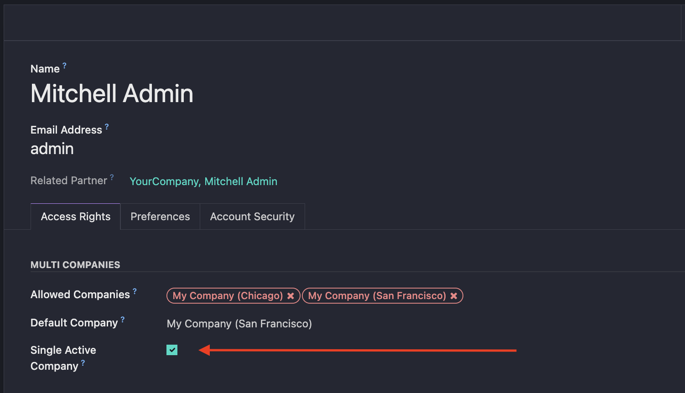
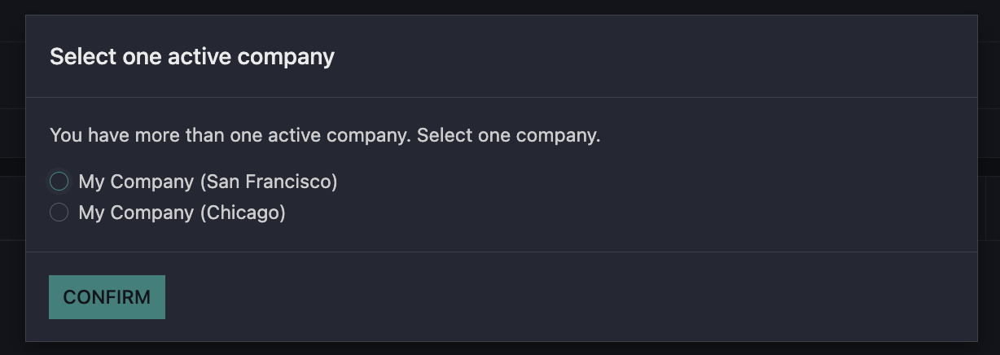

.. image:: https://odoo-community.org/readme-banner-image
   :target: https://odoo-community.org/get-involved?utm_source=readme
   :alt: Odoo Community Association

===========================
Users Single Active Company
===========================

.. 
   !!!!!!!!!!!!!!!!!!!!!!!!!!!!!!!!!!!!!!!!!!!!!!!!!!!!
   !! This file is generated by oca-gen-addon-readme !!
   !! changes will be overwritten.                   !!
   !!!!!!!!!!!!!!!!!!!!!!!!!!!!!!!!!!!!!!!!!!!!!!!!!!!!
   !! source digest: sha256:05163aada6aa9ddbf289d5cb36429d095e9da40b3410406940ec0b1ef55cdbdb
   !!!!!!!!!!!!!!!!!!!!!!!!!!!!!!!!!!!!!!!!!!!!!!!!!!!!

.. |badge1| image:: https://img.shields.io/badge/maturity-Beta-yellow.png
    :target: https://odoo-community.org/page/development-status
    :alt: Beta
.. |badge2| image:: https://img.shields.io/badge/license-AGPL--3-blue.png
    :target: http://www.gnu.org/licenses/agpl-3.0-standalone.html
    :alt: License: AGPL-3
.. |badge3| image:: https://img.shields.io/badge/github-OCA%2Fmulti--company-lightgray.png?logo=github
    :target: https://github.com/OCA/multi-company/tree/16.0/res_users_single_active_company
    :alt: OCA/multi-company
.. |badge4| image:: https://img.shields.io/badge/weblate-Translate%20me-F47D42.png
    :target: https://translation.odoo-community.org/projects/multi-company-16-0/multi-company-16-0-res_users_single_active_company
    :alt: Translate me on Weblate
.. |badge5| image:: https://img.shields.io/badge/runboat-Try%20me-875A7B.png
    :target: https://runboat.odoo-community.org/builds?repo=OCA/multi-company&target_branch=16.0
    :alt: Try me on Runboat

|badge1| |badge2| |badge3| |badge4| |badge5|

This module adds the option Single Active Company on the user form.
The option applies to a user with multi-company access rights.
When the option is enabled, the user can keep one active company.
The user can still have many allowed companies.
The company menu lets the user select one allowed company.
When the user already has more than one active company, a warning dialog opens.
The user must select one company in that dialog and confirm.
The dialog stays open until the user confirms one company.
After confirm, that company is the only active company.

**Table of contents**

.. contents::
   :local:

Use Cases / Context
===================

A user with multi-company rights can activate more than one company at the same time.
Some organizations must keep one active company for a user.
The allowed company list can still contain many companies.
This module adds that limit on the user.

Configuration
=============

The option applies only to a user with multi-company access rights.

- Go to Settings -> Users and Companies -> Users.
- Open a user record.
- Enable Single Active Company.
- Save the record.

Usage
=====

- Log in as the configured user.
- Open the company menu.
- Select one allowed company.
- The selected company becomes the only active company.

When the user already has more than one active company:

- The warning dialog opens.
- The dialog lists the active companies.
- Select one company.
- Click Confirm.
- The selected company stays active.
- The other companies stay allowed.

The dialog stays open until the user selects one company and clicks Confirm.

Bug Tracker
===========

Bugs are tracked on `GitHub Issues <https://github.com/OCA/multi-company/issues>`_.
In case of trouble, please check there if your issue has already been reported.
If you spotted it first, help us to smash it by providing a detailed and welcomed
`feedback <https://github.com/OCA/multi-company/issues/new?body=module:%20res_users_single_active_company%0Aversion:%2016.0%0A%0A**Steps%20to%20reproduce**%0A-%20...%0A%0A**Current%20behavior**%0A%0A**Expected%20behavior**>`_.

Do not contact contributors directly about support or help with technical issues.

Credits
=======

Authors
~~~~~~~

* XXP LLC

Contributors
~~~~~~~~~~~~

* Mikhail Lapin "Bearnard21" <lapin.mike@yahoo.com>
* Maksim Shurupov "geomer198" <geomer198@gmail.com>

Maintainers
~~~~~~~~~~~

This module is maintained by the OCA.

.. image:: https://odoo-community.org/logo.png
   :alt: Odoo Community Association
   :target: https://odoo-community.org

OCA, or the Odoo Community Association, is a nonprofit organization whose
mission is to support the collaborative development of Odoo features and
promote its widespread use.

This module is part of the `OCA/multi-company <https://github.com/OCA/multi-company/tree/16.0/res_users_single_active_company>`_ project on GitHub.

You are welcome to contribute. To learn how please visit https://odoo-community.org/page/Contribute.
