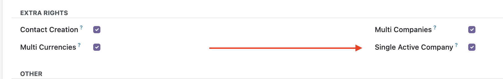

The group is listed in Extra Rights, next to Multi Companies.
Extra Rights is visible in developer mode.
Enabling the group also grants Multi Companies.

- Go to Settings -> Users and Companies -> Users.
- Open a user record.
- Open the Access Rights tab.
- Enable developer mode if Extra Rights is hidden.
- Enable Single Active Company.
- Save the record.

