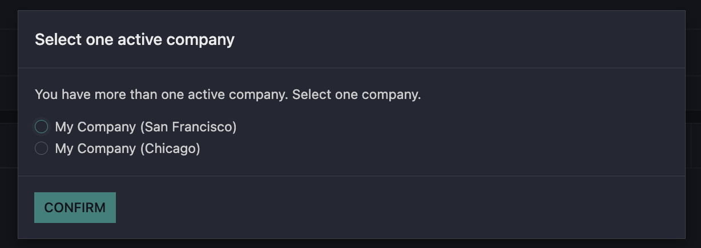

- Log in as the configured user.
- Open the company menu.
- Select one allowed company.
- The selected company becomes the only active company.

When the user already has more than one active company:

- The warning dialog opens.
- The dialog lists the active companies.
- Select one company.
- Click Confirm.
- The selected company stays active.
- The other companies stay allowed.

The dialog stays open until the user selects one company and clicks Confirm.

